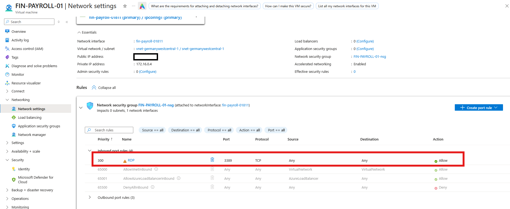
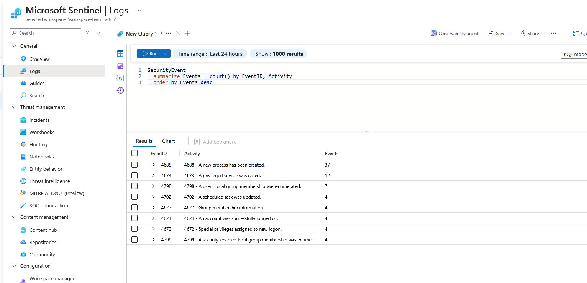

# Day 1 — Phase 1: Deploying the Bait

**Date:** 27 October 2026
**Goal:** Deploy a Windows VM exposed to the internet on RDP and send its security logs to Microsoft Sentinel.

## Setup

| Component | Configuration |
|---|---|
| Resource group | `rg-baitnswitch` (Germany West Central) |
| Log Analytics workspace | `workspace-baitnswitch` with Microsoft Sentinel enabled |
| Virtual machine | `FIN-PAYROLL-01`, Windows Server 2025 Datacenter Azure Edition, Standard D2s v6 (2 vCPUs, 8 GiB), Trusted launch, auto-shutdown disabled |
| Network security group | `FIN-PAYROLL-01-nsg`, inbound rule 300 allows RDP (TCP 3389) from Any |
| Content Hub solution | Windows Security Events |
| Data collection rule | `dcr-secevents-honeypot`, associated with the VM |
| Agent | AzureMonitorWindowsAgent 1.45.0 (provisioning succeeded) |

## The deliberate vulnerability



Rule 300 allows TCP 3389 from any source. All other inbound traffic is blocked by the default rule 65500 `DenyAllInBound`.

## Verification

```kql
SecurityEvent
| summarize Events = count() by EventID, Activity
| order by Events desc
```



Security events from the VM reached Sentinel, which confirms the telemetry chain works. The most frequent event was 4688 (a new process has been created, 37 events). No 4625 (failed logon) events had been recorded yet.

## Issue

Installing the Windows Security Events solution first failed with "Install error". A second installation attempt a few minutes later succeeded.

## Next

Phase 2: attack the honeypot myself and confirm that the failed logons appear in Sentinel.
