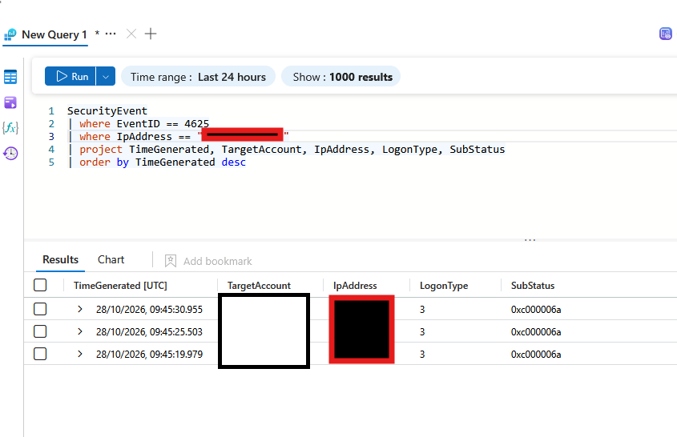
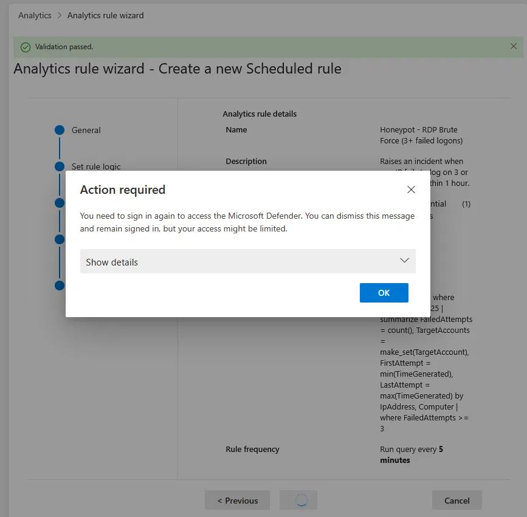
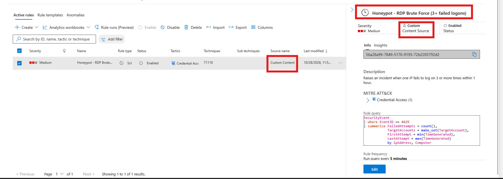
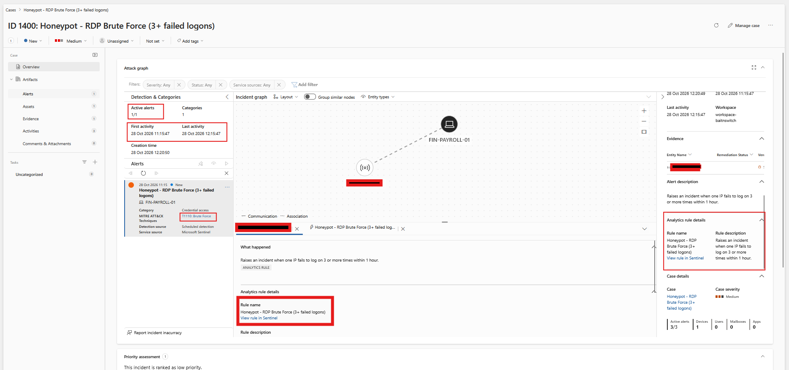
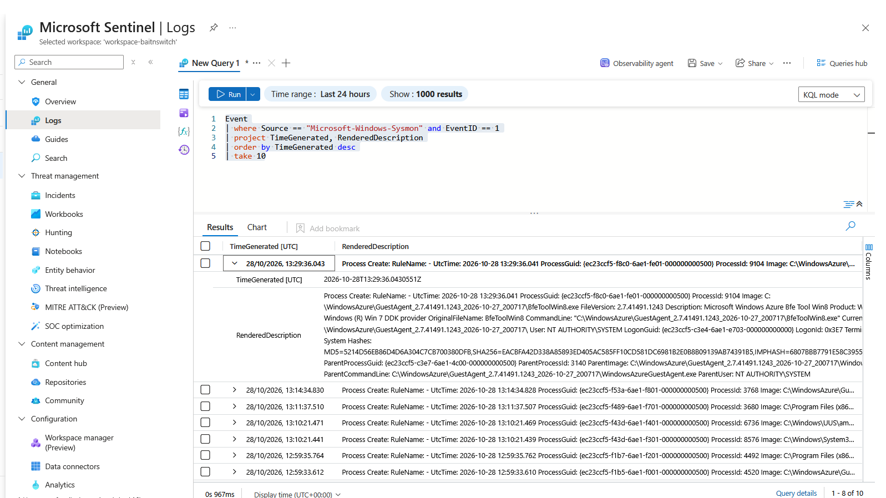

# Day 2 — Phase 2: Smoke Test

**Date:** 28 October 2026
**Goal:** Attack the honeypot myself to confirm that failed logons are logged, detected and turned into an incident in Microsoft Sentinel.

## 1. Manual brute force

I connected to the VM with Remote Desktop and entered a wrong password 3 times (09:45 UTC).

```kql
SecurityEvent
| where EventID == 4625
| where IpAddress == "<my IP>"
| project TimeGenerated, TargetAccount, IpAddress, LogonType, SubStatus
| order by TimeGenerated desc
```



All 3 attempts were logged as Event ID 4625 with LogonType 3 and SubStatus `0xc000006a` (valid username, wrong password).

## 2. Detection rule

| Setting | Value |
|---|---|
| Name | Honeypot - RDP Brute Force (3+ failed logons) |
| Severity | Medium |
| MITRE ATT&CK | Credential Access, T1110 Brute Force |
| Schedule | Runs every 5 minutes over the last 1 hour |
| Entity mapping | IP (IpAddress), Host (Computer) |

```kql
SecurityEvent
| where EventID == 4625
| summarize FailedAttempts = count(),
            TargetAccounts = make_set(TargetAccount),
            FirstAttempt = min(TimeGenerated),
            LastAttempt = max(TimeGenerated)
            by IpAddress, Computer
| where FailedAttempts >= 3
```

**Challenge:** Saving the rule in the analytics rule wizard failed. Validation passed, but on Save the portal showed "Action required: You need to sign in again to access the Microsoft Defender", and the rule was not created.



**Solution:** I deployed the same rule as an ARM template ([`rules/rule-rdp-bruteforce.json`](../rules/rule-rdp-bruteforce.json)) with **Deploy a custom template** in the Azure portal. The rule then appeared in Active rules as Custom Content, Enabled.



## 3. Incident

I repeated the attack (5 failed logons at 11:11 UTC). The rule created incident **ID 1400: Honeypot - RDP Brute Force (3+ failed logons)** with 1 alert. The incident graph links my IP to `FIN-PAYROLL-01`.

The incident is handled in the Microsoft Defender portal (Cases). The screenshot shows it as created (status New, unassigned). I then set its status to **Open**, the Defender equivalent of Active, and assigned it to myself.



## 4. Advanced telemetry: Sysmon

- Installed Sysmon v15.22 on the VM with SwiftOnSecurity's configuration.
- Enabled command-line logging for Event ID 4688.
- Created a second data collection rule, `dcr-sysmon-honeypot`, to send the `Microsoft-Windows-Sysmon/Operational` log to the workspace (table: `Event`).

```kql
Event
| where Source == "Microsoft-Windows-Sysmon" and EventID == 1
| project TimeGenerated, RenderedDescription
| order by TimeGenerated desc
| take 10
```



Sysmon Event ID 1 (Process Create) records each process with its full command line and parent process. Events appear in Sentinel only from the time the data collection rule was created.

## Next

Phase 3 and 4: triage real attacks and investigate a classmate's simulated breach.
